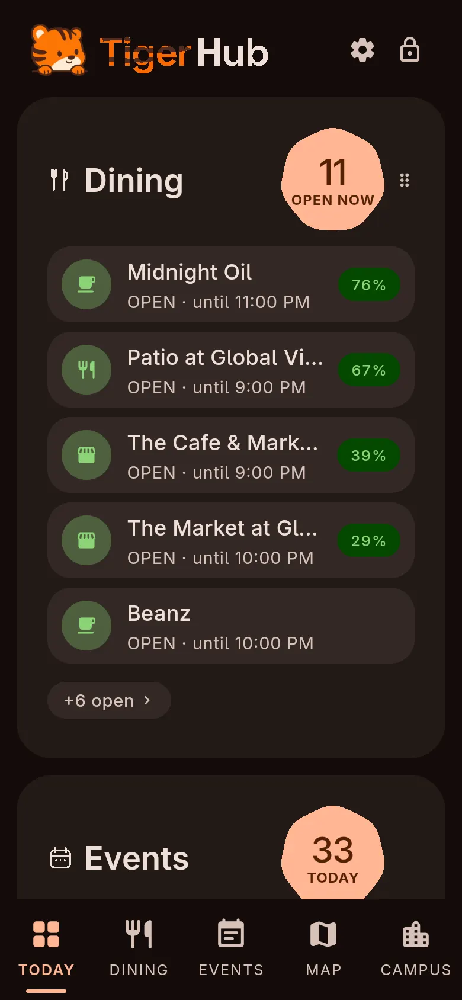
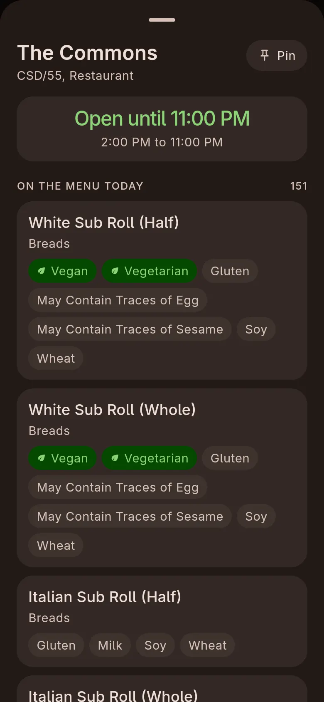
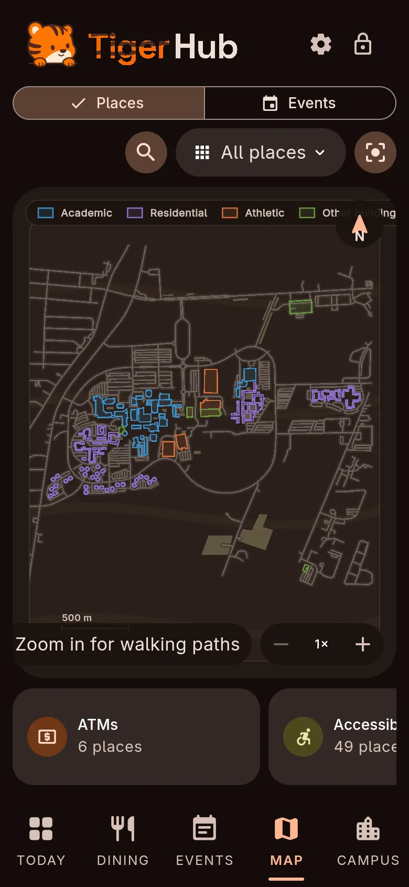
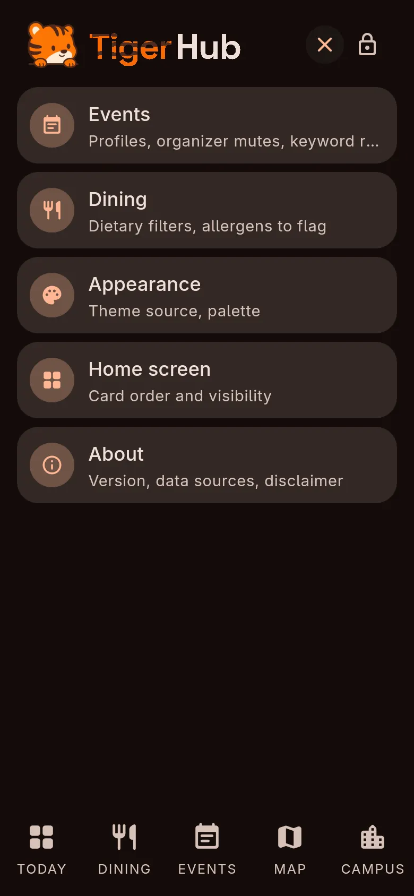
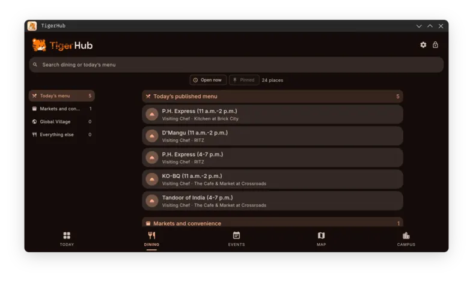

# TigerHub

An app for RIT students that puts dining hours and menus, events, SHED equipment availability, post office hours and campus mail in one place. It's built with Flutter and has no server. The app reads RIT's public endpoints on the device and keeps working offline.

<p>
  
  
  
  
</p>

<p>
  
</p>

Not affiliated with or endorsed by RIT. It only contacts public endpoints and never stores credentials.

## What's in it

The Today tab is a dashboard of cards for dining, events and campus status, and you can reorder them. Dining shows what is open now and the hours for each location. Each location's menu has dietary tags, and you can filter on allergens. Events merges student club events with official university ones, and you can mute organizers or add keyword rules. The map draws campus buildings by category with walking paths and search. The Campus tab has post office hours, mail zones and live SHED makerspace equipment availability.

## How it works

I first ran this as a FastAPI service on my homelab. That box gets rebuilt and rebooted for other projects, so I couldn't promise uptime for something you check between classes, and the scraping moved onto the device.

Every outbound call goes through one client that sets an identifiable User-Agent, timeouts and backoff. A source only refreshes when its stored snapshot is older than that source's cadence: dining hourly, events every 3 hours, makerspace every 15 minutes, occupancy every 5. Opening a tab five times doesn't scrape five times. Menus are fetched only for the location you're viewing and cached for a day. Login-gated endpoints are never contacted.

Every response is stored and replayed on the next launch, so the last known data paints instantly and a stale cache never produces an error screen. Post office hours, mail zone formats and SHED hours ship inside the app, so the lookup you do at a counter with no signal still works.

| Source | What it gives |
|---|---|
| TigerCenter | dining locations and hours |
| rit.edu dining pages | visiting chefs and times |
| CampusGroups iCal | student club events |
| RIT Drupal JSON:API | official university events |
| make.rit.edu GraphQL | SHED equipment availability |
| ritathletics.com iCal | athletics fixtures |
| maps.rit.edu | live occupancy and campus points of interest |
| FD MealPlanner | menus, allergens and dietary tags |
| rit.edu recreation | gym, fitness and pool hours |

Four of the upstreams send no CORS headers, so a browser can't reach them and web isn't a target. It builds for Linux, Android and iOS.

## Run it

```sh
scripts/dev build     # linux release build
scripts/dev app       # launch it
scripts/dev app --dev # flutter run with hot reload
scripts/dev test      # analyze and test
scripts/dev data      # what has been scraped and how old it is
scripts/dev reset     # wipe the snapshots
scripts/dev package   # single-file AppImage in dist/
git config core.hooksPath .githooks # pre-commit keeps agent docs out
```

`scripts/dev package` produces one executable AppImage of about 11 MB that needs nothing installed beyond the usual desktop libraries.

Phone mode is dev only. It shows the app in a centered phone sized box with a matching MediaQuery, so desktop layouts match a phone. The OS window is not resized. Release builds ignore it.

```sh
TIGERHUB_PHONE=1 scripts/dev app --dev                       # 390x844
TIGERHUB_PHONE=430x932 scripts/dev app --dev                 # another size
TIGERHUB_PHONE=1 TIGERHUB_TEXT_SCALE=2.0 scripts/dev app --dev
```

Unset, empty, `0` or `false` is off, and a bad `WxH` falls back to 390x844. `TIGERHUB_TEXT_SCALE` (above 0, up to 4) only applies in phone mode.

## Layout

- `client/` is the Flutter app. `lib/data/sources/` has one scraper per upstream, and `lib/data/local_backend.dart` routes a request to a source and holds the cadence.
- `client/test/golden/` has pinned parser output and captured upstream payloads.
- `client/assets/config/` holds hand-maintained JSON, each file with a last-verified date.
- `assets/` has the wordmark and icon art.
- `scripts/` has dev tooling, and the repo also carries CI and Codemagic config for the Android and iOS builds.
